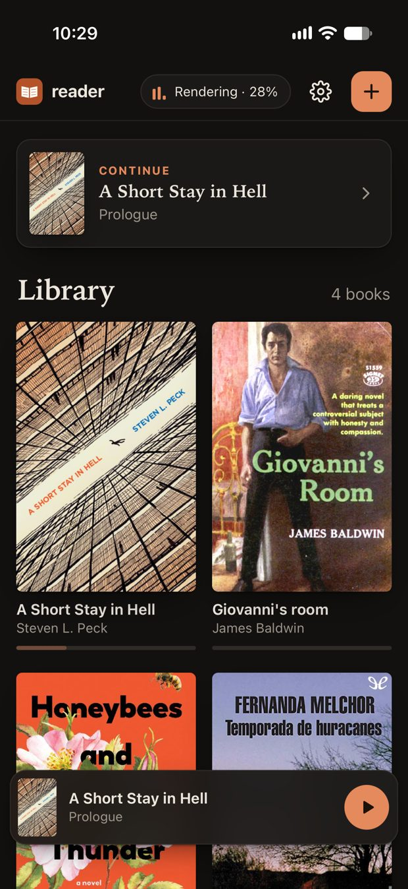
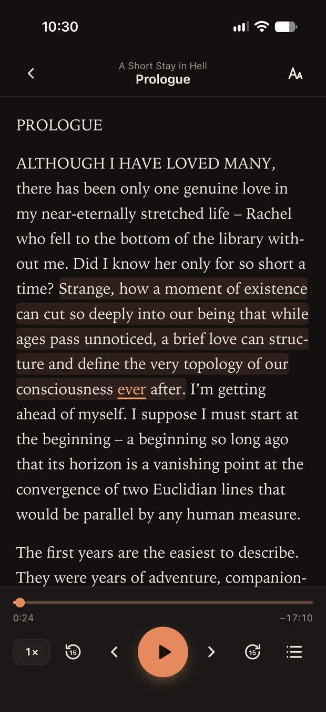
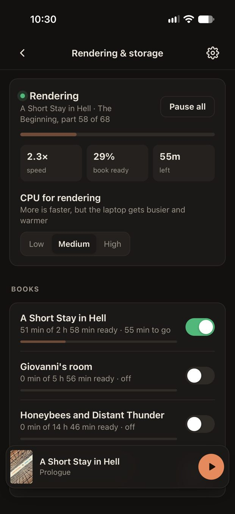

# reader

A self-hosted read-along audiobook app. Add an EPUB, and a local text-to-speech model narrates it in the
background on an ordinary laptop (CPU only). Listen on the phone as an installed web app, with the text following
along: the sentence highlighted, the word underlined. English and Spanish.

<p>
  
  
  
</p>

*On an iPhone, installed from the home screen, in dark mode.*

## What it does

**Narration**
- **Voice.** [Pocket TTS](https://github.com/kyutai-labs/pocket-tts) (Kyutai, 100M) with its LibriVox-narrator
  voices: `caro_davy` for English, `lola` for Spanish.
  - Both were picked in blind listening tests over [Phonon](https://gradium.ai/phonon), Kokoro and calmer voices.
- **Previous-sentence context.** Each sentence's voice prompt includes the end of the sentence before. The narration
  flows instead of every sentence starting the same way.
- **Text that reads right.**
  - Numbers, dates, Roman numerals, ordinals and abbreviations are spelled out (NeMo grammars plus our own rules).
  - Small-caps openings, quoted words that aren't dialogue, and "the book I wanted" (not "book one") are handled.
  - Dialogue and its tag are voiced as one sentence: *"I'm sorry," he said, "it's just that…"*.
- **Checked takes.**
  - Every sentence is force-aligned against its text (MMS). Mumbled, skipped or babbled takes are re-rendered, and the
    alignment provides the word timings.
  - Dead air inside a take is shortened.
  - A wrong sentence ending (a statement rising, a yes/no question not rising) gets a second take; if that one ends
    wrong too, a gentle pitch fix. Everything else is a single take (preferred blind).
- **Mastered like an audiobook.** Even loudness, peaks below −3 dB, room tone in the pauses, pauses scaled to sentence
  and paragraph length.

**Listening**
- **One continuous stream per book (MediaSource).** Chapters follow each other without the audio element ever ending.
  That's what keeps playback going on a locked iPhone.
- **Lock screen and AirPods:** play/pause, ±15 s skips, sentence steps.
  - After any stop (a pause, a call, a navigation prompt) it rewinds a little to a pause between words.
- **A now-playing bar on every screen.** Before anything plays it offers the book you were last listening to, and
  its play button starts it right there.
- **The play button always answers.** A spinner while it loads; a countdown while a part is still rendering
  ("about 25 s, 2 of 6 sentences"), after which it plays by itself; and a plain reason when it can't play (offline and
  not downloaded, rendering paused, server unreachable).
- **Reading.** Sentence highlighting and a word underline. Long sentences highlight and step by clause.
  - Speed control, offline downloads ("next 3 hours" or the whole book), text size and five reading fonts.
- **Time left.** The player shows the time left in the chapter and, roughly, in the book, at your speed. The
  now-playing bar shows both too, with a thin line for the chapter.
- **Background sounds** under the narration (≋ in the reader): rain, a fireplace, waves, space, focus (binaural beats)
  or brown noise, with a volume slider. They are made on the phone as seamless one-minute loops, so there is nothing
  to download and they work offline. They follow play and pause.

**Feels like an iPhone app**
- **Screens push and pop.** They slide in from the right, slide back on Back, and the edge swipe takes you back with
  your finger (the screen before waits underneath). Each screen comes back scrolled where you left it.
- **No waiting between screens.** Every screen paints at once from what the phone already has, then refreshes in
  place. Anything not on the phone yet shows its outline (a skeleton) instead of a blank page.
- **Reopens where you were.** When iOS has closed the app in the background, it opens on the same screen, with Back
  still leading where it should.
- **Native controls:** frosted nav bars with large titles, bottom sheets you pull down to close, action sheets for
  confirmations, the iOS switch and activity indicator, and launch screens in the phone's light or dark colours.
- **Themes:** Auto (Light by day, Dark by night), Light, Dark, Sepia, Paper, Sage, Dusk, Quiet and Black.

**Rendering**
- **Renders from where you are listening.** The next pieces come first, so you rarely wait. Pieces are 30 s, so a part
  that isn't rendered yet starts within about half a minute.
- **Several chapters at once** (the CPU setting picks how many), each its own chain of context. The extra chapters
  hold while the part you're listening to is still rendering, so it arrives sooner.
- **Runs at low priority and gives its memory back** (~5 GB → ~0.3 GB) after 5 idle minutes. The service has a
  memory limit (`MemoryMax=7G`), and extra lanes only start when the laptop has memory to spare.
- **The rendering page shows the laptop:** CPU and memory (the reader's share next to everything else's, and its
  limit), temperature, battery.
- **Survives restarts and upgrades.** Your place is kept by its position in the text; finished chapters keep their
  audio; a player streaming audio that was rebuilt reloads it in place.

## How it works

```
EPUB ─► book.py      chapters → blocks (headings, paragraphs, verse, scene breaks); front/back matter skipped
     ─► segment.py   sentences; dialogue vs narration; intonation kind; pauses
     ─► textnorm.py  spoken form (numbers, dates, abbreviations, Roman numerals …)
     ─► render.py    Pocket TTS take, with the previous sentence as context ─► MMS forced alignment (verify + word
                     timings) ─► dead-air squash, ending fix ─► per-sentence cache
     ─► worker.py    30 s pieces, then one file per chapter (AAC); render lanes; fragmented copies for streaming
     ─► server.py    FastAPI: library, chapters, stream files (byte ranges), positions, status
     ─► web/app.js   vanilla-JS PWA: MediaSource "tape" player, read-along, offline store (IndexedDB)
```

More detail: [DESIGN.md](DESIGN.md) (the original design), [docs/roadmap.md](docs/roadmap.md) (what changed and
why), [docs/deploy.md](docs/deploy.md) (hosting).

## Running it

Requires `uv`, `ffmpeg` and Python 3.12. Pocket's voice-cloning weights are gated on Hugging Face (accept the terms
at huggingface.co/kyutai/pocket-tts and log in) and are needed for the context prompts.

```
uv sync
./stack local                                   # http://127.0.0.1:8130 (web app + renderer in one process)
uv run pytest -q                                # text, segmentation and dialogue regression cases
uv run reader script BOOK.epub -c 4             # what will be spoken for chapter 4 (no audio)
uv run reader render BOOK.epub -c 4 -n 20       # render part of a chapter to renders/
uv run reader qa [BOOK]                         # the rendered sentences most worth a listen, with timestamps
```

As a service: `./stack install`, `./stack deploy`, `./stack status`, `./stack logs` (see [docs/deploy.md](docs/deploy.md)).

**Trying changes safely:** run a second instance on a copy of the library, never the live one:

```
cp -al data/books /tmp/copy/books && cp -r data/cache /tmp/copy/cache
READER_DATA=/tmp/copy READER_PORT=8131 uv run python -m reader.server         # READER_NO_WORKER=1: serve only
```

Settings (environment, e.g. in `~/.config/reader/env`):

| Variable | Default | |
|---|---|---|
| `READER_DATA` | `~/reader/data` | books, audio, take cache, positions, `client.log` (the phone's playback log) |
| `READER_PORT` | `8130` | |
| `READER_THREADS`, `READER_NICE` | `4`, `10` | renderer CPU (also set in the app: Low / Medium / High) |
| `READER_CONTEXT` | `1` | previous-sentence context for Pocket voices |
| `READER_IDLE_RELEASE` | `300` | seconds idle before models are unloaded |
| `READER_ACCESS_TEAM`, `READER_ACCESS_AUD` | | Cloudflare Access, checked on every request through the edge |

## Layout

```
reader/        the app: book · segment · textnorm · engine · render · align · prosody · reshape · timing ·
               library · worker · server · cli · web/
tests/         regression cases for text and segmentation
infra/         systemd units, Cloudflare tunnel + edge Worker
docs/          roadmap, deploy notes, screenshots
bakeoff/       (not in git) the model bake-offs and blind listening reels
```
